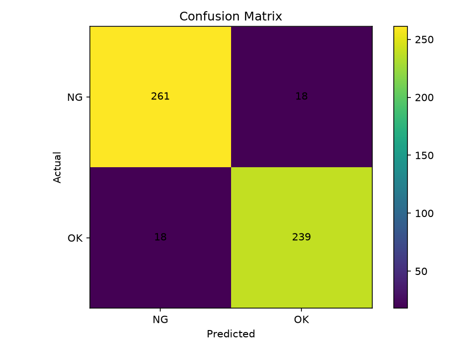

# Industrial Defect Inspection

Проект компьютерного зрения для автоматического определения дефектов промышленных деталей.

Модель классифицирует изображения головок винтов на два класса:

- `NG` - дефектная деталь
- `OK` - нормальная деталь

Проект написан на Python с использованием PyTorch.

## Current results

Модель была обучена на M2 Screw Head Defect Dataset.

`HEAD/Train` разделён на обучающую и validation выборки в соотношении 80/20. Во время обучения сохраняется модель с лучшим результатом на validation.

Лучший результат на validation: **97.75%**.

Результаты лучшей модели на отдельной тестовой выборке:

| Metric | Result |
|---|---:|
| Accuracy | 93.28% |
| Precision NG | 93.55% |
| Recall NG | 93.55% |
| F1 NG | 93.55% |
| Recall OK | 93.00% |

Особенно улучшился Recall NG: модель стала значительно реже пропускать дефектные детали.

## Confusion Matrix



## Real-world testing

После оценки модели на M2 Screw Head Defect Dataset была проведена дополнительная проверка на собственных фотографиях винтов, снятых на смартфон.

На изображениях из исходного датасета модель показывает стабильные результаты, однако на реальных фотографиях качество заметно ниже.

Это связано с **domain shift** - различием между изображениями обучающего датасета и фотографиями из реального мира.

Основные различия:

- другой фон;
- другое освещение;
- другой масштаб объекта;
- другой ракурс;
- различия камеры;
- отличия внешнего вида винтов.

Для уменьшения domain shift был создан небольшой набор собственных изображений `OK` и `NG` и проведён эксперимент с fine-tuning.

Во время fine-tuning использовались:

- собственные реальные фотографии;
- data augmentation;
- RandomRotation;
- ColorJitter;
- отдельная validation выборка;
- сохранение лучшей модели по validation accuracy.

Эксперимент показал, что маленького набора реальных фотографий пока недостаточно для стабильного улучшения качества. Fine-tuned модель сильно зависит от состава обучающих изображений и может смещаться в сторону одного из классов.

Поэтому текущая базовая модель остаётся основной версией проекта, а дальнейшая работа будет направлена на увеличение real-world датасета и улучшение обобщающей способности модели.

## Project structure

```text
industrial-defect-inspection/
├── model.py
├── train.py
├── evaluate.py
├── inference.py
├── finetune.py
├── models/
│   └── defect_cnn.pth
├── assets/
│   └── confusion_matrix.png
├── requirements.txt
├── README.md
└── .gitignore
```

`model.py` содержит архитектуру CNN.

`train.py` загружает обучающий датасет, разделяет его на train и validation, обучает модель на GPU и сохраняет лучшую версию.

`evaluate.py` загружает сохранённую модель и оценивает её на отдельном тестовом наборе данных.

`inference.py` выполняет предсказание для отдельного изображения и показывает уверенность модели.

`finetune.py` используется для экспериментов с дообучением модели на собственных фотографиях винтов.

## Model architecture

Модель представляет собой простую CNN:

```text
RGB image 128x128
        ↓
Conv2d 3 → 16
        ↓
ReLU
        ↓
MaxPool
        ↓
Conv2d 16 → 32
        ↓
ReLU
        ↓
MaxPool
        ↓
Flatten
        ↓
Linear
        ↓
NG / OK
```

Для обучения используется:

- CrossEntropyLoss
- Adam optimizer
- batch size 32
- CUDA, если доступна NVIDIA GPU
- data augmentation
- train/validation split
- сохранение лучшей модели по validation accuracy

## Dataset

Используется M2 Screw Head Defect Dataset.

Датасет содержит изображения нормальных и дефектных головок винтов.

Сам датасет не хранится в репозитории.

Ожидаемая структура:

```text
HEAD/
├── Train/
│   ├── NG/
│   └── OK/
└── Test/
    ├── NG/
    └── OK/
```

## Training

Запуск обучения:

```bash
python train.py
```

После обучения лучшая модель сохраняется:

```text
models/defect_cnn.pth
```

## Evaluation

Для оценки обученной модели:

```bash
python evaluate.py
```

Скрипт рассчитывает:

- Accuracy
- Precision для дефектных деталей
- Recall
- F1-score
- Confusion Matrix

## Inference

Для проверки отдельного изображения:

```bash
python inference.py
```

Скрипт выводит класс:

```text
Predict: OK
```

или:

```text
Predict: NG
```

а также уверенность модели.

## Fine-tuning

Для экспериментов с дообучением модели на собственных фотографиях:

```bash
python finetune.py
```

Fine-tuning использует отдельные train и validation данные и сохраняет лучшую версию модели.

## Roadmap

В следующих версиях планируется добавить:

- увеличение real-world датасета
- улучшение качества на реальных фотографиях
- улучшенную архитектуру CNN
- график обучения
- anomaly detection
- локализацию дефекта
- heatmap дефектной области
- возможный перенос облегчённой модели на ESP32-S3